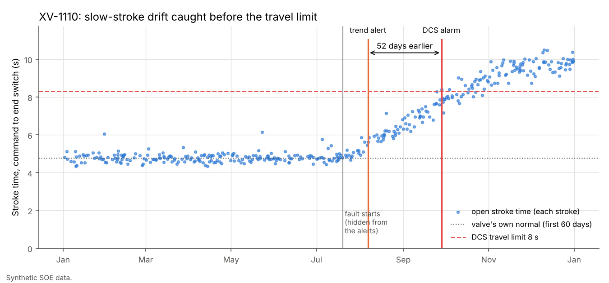
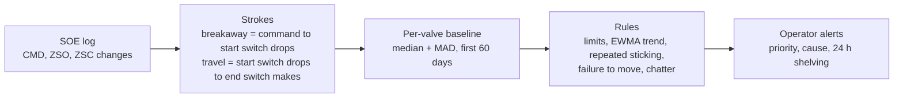
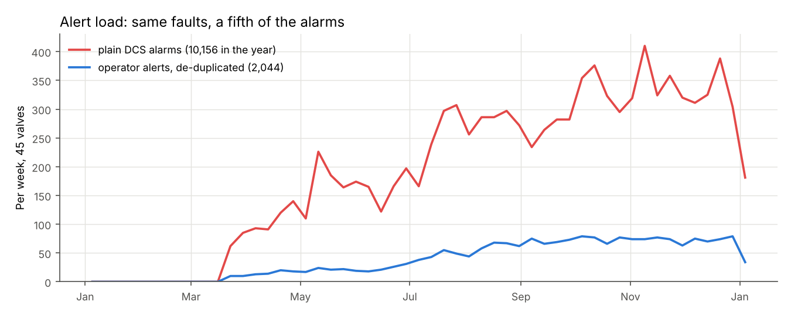

# Valve limit-switch alerts

**Use the limit-switch timing every on/off and shutdown valve already sends to the DCS to warn operators and maintenance before a valve fails to close in time, and to replace floods of raw position alarms with a few alerts that name the likely cause.**




## Problem statement

A shutdown valve that closes too slowly can defeat the safety function it belongs to. A process on/off valve that sticks or fails to travel trips units and spoils batches. The evidence builds up for weeks in the sequence-of-events (SOE) record: every command, and the moment each limit switch drops and makes. But a plain DCS only uses it for a fixed travel-timeout alarm, which fires once the valve is already too slow. Meanwhile a loose switch cam can raise hundreds of "uncommanded change" alarms a week. That is the nuisance load ISA-18.2 alarm management sets out to remove.

## Features

- Rebuilds every valve stroke from raw SOE records, splitting **breakaway** time from **travel** time
- Learns each valve's own normal stroke time per direction, instead of one fleet-wide threshold
- Seven alert rules: failure to move, travel not confirmed, limit exceeded, slow-stroke trend (with a projected date), sticking, chattering switch, uncommanded change
- ISA-18.2 style handling: chatter raised once, repeats within 24 h suppressed and counted
- Scores every alert against injected faults and against what a plain DCS would have raised
- FastAPI `/alerts` endpoint that runs the same rules on one valve's SOE records

## Tech stack

| Tool | Used for | Why this one |
|---|---|---|
| Python, pandas | SOE parsing, strokes, alert rules | Event logs are tabular; the parser is a readable state machine per valve |
| NumPy | Median / MAD baselines, EWMA trend, projected date | Robust statistics a control engineer can check by hand |
| Matplotlib | Drift timeline, alert-load chart | |
| FastAPI | `/alerts` endpoint | The course's deployment step: lightweight, with interactive docs |
| pytest, GitHub Actions | Parser edge cases, trend vs one-off slow strokes, sticking, chatter, API | Run on every push |

## Approach



| Stage | Where | Technique | Why this one |
|---|---|---|---|
| Data | `src/data/` | Simulated one-year SOE log (CMD, ZSO, ZSC) for 45 valves, with injected faults; timestamps parsed and points split into tag and signal | Real SOE logs can't be published; injected faults give the truth to score against |
| Features | `src/features/` | One row per stroke: breakaway, travel, total time and status; uncommanded switch changes kept apart | Separating breakaway from travel is what exposes sticking |
| Model | `src/models/` | Per-valve baseline: median and MAD from the first 60 days, saved to `models/` | Each valve has its own normal |
| Alert rules | `src/alerts/` | Limits, EWMA trend, repeated sticking, failure to move, chatter, 24 h shelving | Transparent rules an operator and a C&I engineer can agree on |
| Evaluation | `src/models/` | First alert after onset vs first plain DCS alarm; cause named; false alerts; alert load | Measured in operator terms, not ML scores |
| Deployment | `src/api/` | FastAPI `/alerts` | Check one valve's history without the full pipeline |

| Alert | Priority | What triggers it | Why this technique |
|---|---|---|---|
| Failure to move | High | Command given, start switch never drops | Unambiguous, so it needs no statistics |
| Travel not confirmed | High | Valve left its end position but the other switch didn't make in time | Says plainly that it's *either* a part-open valve *or* a switch fault; the field check decides which |
| Limit exceeded | High for SDV closing, Medium otherwise | Stroke time above the required closing time (SDV) or travel timeout (XV) | The existing hard limit, kept as is |
| Slow-stroke trend | Low | EWMA of stroke time against the valve's **own** baseline above +12%, with the last 3 strokes all slow; the message gives a projected date for reaching the limit | Each valve has its own normal time, so one fleet-wide threshold would be too loose for some valves and too tight for others. EWMA filters single slow strokes (cold start, low air) |
| Sticking | Low | Breakaway time more than 3× normal in at least 2 of the last 6 strokes | A valve that hesitates before moving can still finish in time; separating breakaway from travel exposes it |
| Chattering switch | Medium | 3 or more uncommanded changes of one switch within 60 s; one alert, then shelved for 24 h | ISA-18.2 chattering-alarm handling |

Repeats of the same alert on the same valve within 24 hours are suppressed and counted rather than re-announced.

Example messages (taken from `reports/operator_alerts.csv`):

| Priority | Message |
|---|---|
| Low | XV-1127 open time trending up: 3.6 s vs normal 3.1 s (+19%), projected to reach the 5.3 s limit in about 21 days. Check air supply, actuator, packing |
| Low | XV-1113 hesitating on close: breakaway 3.1 s vs normal 0.6 s (2 of last 6 strokes) |
| High | XV-1102 open command: open switch not made within 8 s: valve stuck part-way or open switch fault |
| High | SDV-2110 did not leave open position on close command |
| Medium | SDV-2106.ZSO chattering: 7 changes in 60 s with no command |

## Project structure

```
valve-limit-switch-alerts/
├── data/
│   ├── raw/             simulated SOE log and valve register; ground_truth/ (injected faults) for scoring only
│   ├── processed/       one row per stroke
│   └── sample/          SOE records of one healthy and one drifting valve
├── models/              per-valve baselines + model card
├── notebooks/           01_walkthrough.ipynb: every stage with outputs
├── reports/             operator_alerts.csv, fault_detection.csv, metrics.json, figures/
├── src/
│   ├── api/             FastAPI service
│   ├── data/            generate_events, load_data, preprocess
│   ├── features/        strokes
│   ├── models/          baseline, evaluate (scoring + robustness)
│   ├── alerts/          rules (alerts, shelving, plain DCS alarms for comparison)
│   ├── utils/           paths, plots
│   └── pipeline.py      stages wired together
├── tests/               unit and API tests
├── .github/workflows/   CI: tests + full pipeline on every push
├── requirements.txt
├── README.md
└── main.py              runs every stage
```

## How it was validated

The SOE log is simulated: 45 valves (30 process on/off XVs cycling several times a day, and 15 SDVs stroke-tested weekly) over one year. Twenty faults are injected at random hidden onset times, four of each type: slow-stroke drift, intermittent sticking, failure to move, end-switch failure and a chattering switch. About 1% of healthy strokes are one-off slow strokes that should **not** raise an alert.

1. **Detection and timing** for every injected fault: the first matching alert after onset, against the first plain DCS alarm (travel timeout / travel failure / uncommanded change).
2. **Right cause named:** did an alert of the matching kind fire, not just any alert?
3. **False alerts:** any alert on a healthy valve, or on a faulty valve before its fault began.
4. **Alert load** against the plain DCS alarms, in ISA-18.2 terms (alerts per day, peak day).
5. **Six simulated fleets** (seeds), so the result is not one lucky draw: `python main.py --robustness`.
6. **Unit tests** for stroke parsing (including a stroke that starts with its switch already off because of an earlier switch fault), trend versus one-off slow strokes, the sticking-repeat rule, and chatter shelving.

Testing exposed two problems, both fixed:
- After an end-switch fault, the parser called the next healthy stroke "failed to move".
- One-off slow strokes on an SDV were being recorded as a drift's first limit breach.

## Results

| Fault (4 each) | Detected | Cause named | Median delay after onset | Ahead of the plain DCS alarm |
|---|---|---|---|---|
| Slow-stroke drift | 4 / 4 | 4 / 4 | 14 days | **16, 40 and 52 days** on the three XVs; 0 on the weekly-tested SDV |
| Sticking | 4 / 4 | 4 / 4 | 1.2 days | same time (the long hesitation also tripped the travel limit) |
| Failure to move | 4 / 4 | 4 / 4 | 5.7 days | same time (the first failed stroke) |
| End-switch failure | 4 / 4 | 4 / 4 | 0.4 days | same time |
| Chattering switch | 4 / 4 | 4 / 4 | 0.1 days | same time |

| Alert load (one year, 45 valves) | Operator alerts | Plain DCS alarms |
|---|---|---|
| Total | **2,044** | 10,156 |
| Per day (mean / peak day) | 7.1 / 16 | 35.1 / 86 |
| From the 4 chattering switches | 613 | 6,470 |
| False alerts (25 healthy valves, and before onset) | **0** | — |



**Across six simulated fleets (120 faults):** all 120 detected, with the right cause named for 119, and 3 false alerts in total, about one per 90 valve-years. Two were early "trend" alerts on healthy valves after a run of slow strokes. One was a healthy SDV whose one-off slow closure really did exceed its closing spec, so the plain DCS alarmed too. Operator alerts were 20–28% of the plain DCS alarm count. For drift, the trend alert came ahead of the travel-limit alarm by a median of **31 days on process valves** (range 9–63) but only **4 days on SDVs** (range 0–10). An SDV is stroked only weekly, so a fast drift reaches the limit within a few tests.

**What this means in practice.** The gain is in two places:
- **Slow drift on frequently-cycled valves.** Weeks of warning give time to fix the air supply or actuator before the valve fails its stroke.
- **Alert quality.** Each alert names the likely cause, and a fifth of the alarms means operators actually see them.

Sudden failures are found at the first failed stroke, just as the DCS finds them. For SDVs, the honest conclusion is that a weekly test gives too few data points for an early warning. A partial-stroke test, or a richer signal (actuator pressure), would be needed.

The load grows through the simulated year because faulty valves are never repaired in the simulation. In a plant, each alert would lead to a work order.

### Limits

- The baseline is learned once, from the first 60 days. After maintenance on a valve, it should be re-learned.
- Thresholds (12% trend, 3× breakaway, 3 changes in 60 s) are tuned on simulated data and would need tuning on a real plant's history.
- Only limit-switch timing is used. Smart positioners and partial-stroke tests give richer data, especially for SDVs.
- Simulated noise is simpler than the real thing: no air-header events affecting many valves at once, no DCS scan-time effects.

## What makes it different

- **It uses data the plant already has.** No new sensors: just the command and limit-switch timestamps already in the SOE record.
- **It names the cause.** "Hesitating on close" or "open switch not made" tells the technician where to look, unlike a generic travel alarm.
- **It is honest about where it doesn't help.** On weekly-tested SDVs the lead time is small, and the README says so.

## How to run

```bash
python -m venv .venv && source .venv/bin/activate
pip install -r requirements.txt
python main.py                          # strokes, alerts, scoring, figures (about 10 s)
pytest                                  # unit and API tests
uvicorn src.api.app:app --reload        # API; open http://127.0.0.1:8000/docs
```

`python main.py --regenerate --seed 7` simulates a different fleet, and `python main.py --robustness` repeats everything on six simulated fleets (about 1 min). The notebook `notebooks/01_walkthrough.ipynb` shows every stage with its outputs.

## What I learned

- **Edge cases live in the parser.** The worst bug was not in the alert logic: after an end-switch fault, the parser called the next healthy stroke "failed to move".
- **One slow stroke is not a trend.** An EWMA against the valve's own baseline, plus three slow strokes in a row, kept one-off cold starts from raising alerts.
- **Sampling rate limits prediction.** A weekly-tested SDV gives too few strokes for an early warning, however good the method.

## Data note

**All data in this repository is simulated** by `src/data/generate_events.py`. Valve tags, timings, limits and faults are invented. No employer data, SOE logs, DCS exports, valve lists or plant names were used.

This is a public re-implementation of a personal prototype built on sample data. It has not been deployed at any plant.

## Credits

Built with Claude Code; design, requirements and validation by Raja (Rajayoganandha Sekaran).

Contact: instruraja@yahoo.com

Licence: MIT.
